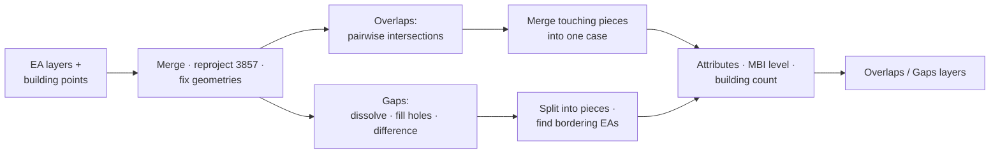

# EA MBI Checker

**Script:** [`gmd_processing_tools/EA_topochecker.py`](../../gmd_processing_tools/EA_topochecker.py)
**Menu:** GMD CO Processing › EA Tools › EA MBI Checker

Finds boundary discrepancies (MBIs) between EA polygons — **overlaps** and **gaps** — and counts the
building points inside each one. The result layers are added to the project; nothing is written to disk.

---

## Run it

1. Load the EA layer(s) and building point layer(s) into the project.
2. Open **EA MBI Checker** and choose:
   - **EA layers** — one or more (they need `geocode` and `ea_geocode`; EPSG:4326 expected);
   - **Building point layers**;
   - **Run mode** — Overlaps and Gaps · Overlaps Only · Gaps Only.
3. Run. The **Overlaps** and **Gaps** layers are added, styled with `styles/mbi_checker.qml`.

Headless: fill in `EA_LAYER_NAMES`, `BLDG_LAYER_NAMES` and `RUN_MODE` in the CONFIG block at the top of
the script, then run it from the Python console.

---

## How it works

1. **Prepare.**
   - The selected EA layers are merged into one layer, and so are the building point layers.
   - Both are reprojected to EPSG:3857 and their geometries repaired.
2. **Overlaps.**
   - Every EA is split into single parts.
   - For each pair of parts whose bounding boxes meet (found with a spatial index), the intersection's
     polygon pieces are kept.
   - Pieces that share area or an edge are unioned, so an overlap running across three or more EAs becomes
     **one case**. Pieces touching only at a corner stay separate.
3. **Gaps.**
   - All EAs are dissolved into one shape and its holes are filled.
   - The difference between the filled shape and the dissolved EAs is the gaps; each gap piece is one case.
   - An EA counts as involved only if it shares at least 0.01 m of edge with the gap.
4. **Attributes.** Each case gets one row per ordered pair of involved areas (this area → other area),
   carrying:
   - the area's admin fields;
   - `involved_areas` / `involved_bgys` / `involved_eas`;
   - the **MBI level** — the most severe boundary the pair crosses (region › province › city/municipality ›
     barangay › within barangay).
5. **Buildings.** The building points inside each piece are counted (`num_bldg_pts`). A piece of
   **0.1 m² or less with no building** is dropped as a sliver; a tiny piece holding a building is kept.
6. **Output.** The Overlaps and Gaps layers are added to the project as scratch layers and styled.

---

## How cases are formed

- Each contiguous overlap or gap is **one case** (`case_uuid`), even when it runs across more than two EAs.
- The layer has **one row per ordered pair** of involved areas (this area → other area), all sharing the
  case's `case_uuid` and geometry.
- A gap counts an area as involved only if they share at least 0.01 m of edge (corner touches are ignored).

## MBI levels

The most severe administrative boundary the pair crosses:

| Value | Meaning |
|-------|---------|
| `1_Inter-Region` | Areas in different regions |
| `2_Inter-Province` | Different provinces |
| `3_Inter-City/Municipality` | Different cities / municipalities |
| `4_Inter-Barangay` | Different barangays |
| `5_Within-Barangay` | Same barangay |

## Output fields

| Field | Contents |
|-------|----------|
| `case_uuid` | Case ID |
| `geocode`, `ea_geocode`, `ea_name`, `region`, `province`, `city_mun`, `barangay` | The row's own area |
| `mbi_level` | See above |
| `involved_areas`, `involved_bgys`, `involved_eas` | Every area of the case |
| `count_involved_areas` | How many areas |
| `num_bldg_pts` | Building points inside the piece |

The EA Selector tab of the [MBI Coverage Selector](mbi_coverage_selector.md#ea-selector-rules) can read this layer in its original EA mode.
