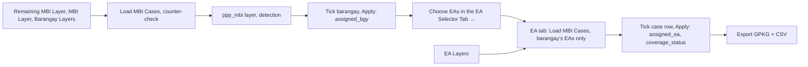

# MBI Coverage Selector

**Script:** [`gmd_processing_tools/mbi_coverage_selector.py`](../../gmd_processing_tools/mbi_coverage_selector.py)
(tabs: [`_mbi_bgy_selector.py`](../../gmd_processing_tools/_mbi_bgy_selector.py),
[`_mbi_ea_selector.py`](../../gmd_processing_tools/_mbi_ea_selector.py))
**Menu:** GMD CO Processing › MBI Coverage Selector

Decides who covers each MBI (gap, overlap or disputed area) in two steps, in one window. The
**Barangay Selector** tab counter-checks the MBI layer against the remaining MBIs and writes the covering
barangay (`assigned_bgy`). The **EA Selector** tab then chooses the EA of that barangay and writes
`assigned_ea` and `coverage_status`.

The MBI Layer comes from the [National-Level MBI Checker](national_mbi_checker.md). The remaining MBIs
come from GEMMA's MBI Validator (`ref_mbi_reviewed-….gpkg`, layer `remaining_cases`).

---

## The window

| Part | What it does |
|------|--------------|
| **Barangay Selector** tab | Counter-check, then tick the covering barangay of each MBI |
| **EA Selector** tab | Tick the covering EA(s) inside that barangay |
| **Help and Information** tab | The same guidance as this page |
| **Minimize** / **Close** | Only hide the window. Open **MBI Coverage Selector** again to resume both tabs as you left them; the layer lists are refreshed. |

- Switching tab clears the other tab's highlights on the map.
- Nothing is kept after QGIS closes. Export or save your edits first.

---

## Quick start

**Barangay Selector tab**

1. **Remaining MBI Layer**: pick the MBIs declared pending. A layer named `remaining_cases`,
   `pending_cases` or `ref_mbi_cases` is picked automatically. Not loaded yet? Click the folder button
   (**Browse GPKG…**) and open the `ref_mbi_reviewed-….gpkg`.
2. **MBI Layer**: pick the MBIs to cover (needs `case_uuid`). Optional: **Only selected MBI features**.
   **Resume saved coverage choices** (on by default) pre-ticks barangays already applied.
3. **Building Points**: pick the layer and its **Geocode field:** (auto: `bgy_geocode`, `geocode`, then
   `ea_geocode`).
4. **Barangay Layers**: tick every layer the involved barangays come from (**Select All** / **Clear**;
   **Selected layers: n / m** shows the count).
5. Click **Load MBI Cases** (green). **Cancel** stops a running load. **Clear** empties the viewer and the log.
6. Tick the **Role / Status** box of the covering barangay in each case.
7. Click **Apply Coverage** (writes `assigned_bgy`). Optional: **Join MBI to Barangays**, **Export GPKG + CSV**.
8. Click **Choose EAs in the EA Selector Tab →**.

**EA Selector tab**

1. **MBI Results Layer**: the `ppp_mbi` layer is already picked when you came from step 8.
2. **EA Layers**: tick the EA layers of the covering barangays (**Select All** / **Clear**).
3. **Building Points (Optional)**: pick the layer and its **Geocode field:** (`ea_geocode`, then `geocode`).
4. Click **Load MBI Cases**.
5. Tick the **case row**: the EA(s) listed under it cover the MBI. Right-click an EA row to pick one yourself.
6. Click **Apply Coverage**, then **Export GPKG + CSV**.

> **Nothing is saved until you say so.** Apply edits the MBI layer in a normal QGIS edit session:
> **Save Edits** to keep, **Edit › Undo** / **Discard Edits** to revert. The remaining MBI layer, the
> barangay layers, the EA layers and the building points are never edited. The EA tab never changes
> `assigned_bgy`.

---

## How it works

1. **Counter-check** (Barangay tab, on **Load MBI Cases**). Each MBI of the MBI Layer is compared with the
   remaining MBIs. They match when they share more than 0.01 m² (`MATCH_MIN_M2`); touching does not count.
   The type must be the same, but a remaining Disputed or untyped MBI matches any type. Areas are
   ellipsoidal m². Each MBI gets a **Detection** value (table below).
2. **Build `ppp_mbi`.** A memory layer with one row per involved barangay is added and replaces the MBI
   Layer in the picker. Building points are counted per case (inside the MBI) and per barangay (geocode
   match, below).
3. **Decide the barangay.** You tick the covering barangay. An overlap across 3 or more barangays can be
   shared out; the barangay ticked first keeps a shared piece.
4. **Write `assigned_bgy`.** **Apply Coverage** writes the ticked geocodes, comma-joined in tick order, on
   every row of the case. *No longer detected* MBIs are left alone.
5. **Hand off.** **Choose EAs in the EA Selector Tab →** applies pending choices and switches tab.
6. **Build EA cases** (EA tab). Rows with no `assigned_bgy` and *No longer detected* rows are skipped (the log
   gives the counts). Each MBI becomes one case per covering barangay. A shared MBI is clipped per barangay:
   MBI ∩ the union of its EAs, minus what earlier barangays keep. If that leaves 0.5 m² or less, the whole MBI
   is kept (logged).
7. **Find the barangay's EAs and candidates** (rules below), measured in EPSG:3857 scaled by cos(latitude)
   for a geographic CRS.
8. **Decide the EA and write.** You tick the case row. **Apply Coverage** writes `assigned_ea` and
   `coverage_status` on the covering barangay's rows and adds `ppp_mbi_ea_clipped`. Export writes the files.

---

## Barangay Selector rules

**Detection**

| Value | Meaning |
|-------|---------|
| *Still detected* | The MBI matches a remaining MBI |
| *Newly detected* | The MBI matches no remaining MBI (light green row) |
| *No longer detected* | A remaining MBI no MBI matches. Cannot be ticked; Apply leaves it alone |
| *Not checked* | A remaining MBI of a type the MBI Layer lacks. Disputed / untyped ones need all 3 types checked. Still to be covered |

**Choosing the barangay**

| Case | Rule |
|------|------|
| Gap, 2 barangays, or an overlap that cannot be shared | One barangay. With 2 candidates, ticking one unticks the other |
| Shared overlap | Not a gap, more than 2 candidates, every candidate has a part, and the parts sum to more than 0.5 m². Tick several; each keeps its part. The one ticked first keeps a shared piece |
| Fully covered | Leftover ≤ max(0.5 m², 0.1% of the MBI) (`SLIVER_M2` = 0.5, `SLIVER_SHARE` = 0.001) |

- **Building count per barangay:** exact geocode match, else the longest prefix. Leading zeros are normalised.
- **Duplicate geocode across layers:** the first selected layer wins; the duplicates are logged.

**Right panel:** search box, the case filter drop-down (All cases, Pending, Partly covered, Covered, Newly detected,
Still detected, No longer detected, Not checked, Overlaps, Gaps, then one entry per level). Columns:
**MBI Case / Bgy Geocode**, **Detection**, **MBI Level**, **Barangay**, **City / Municipality**, **Bldg Pts**,
**Role / Status**.

**From 1 to 2:** **Choose EAs in the EA Selector Tab →** refuses when **Coverage field:** is not
`assigned_bgy`, or when no MBI is covered or partly covered. Ticked barangay layers that carry `ea_geocode`
are pre-ticked on the EA tab.

---

## EA Selector rules

- **Barangay key:** the first 8 digits (`BGY_DIGITS` = 8; a 13-digit code is zero-padded to 14). An EA's
  barangay comes from the EA layer's barangay field, else the 8-digit prefix, else the longest prefix.
  See [Geocodes](../README.md#geocodes).
- **EAs within [5.0] m of a gap** (0–1000): shown only when the layer has `assigned_bgy` (barangay mode,
  automatic).

| MBI | EAs offered |
|-----|-------------|
| Overlap / disputed | EAs with a part > 0.5 m², largest first |
| Gap, or no EA holds > 0.5 m² | EAs within the gap distance (`GAP_SEARCH_M`, default 5 m), nearest first |
| None that close | The 3 nearest EAs (`NEAREST_FALLBACK` = 3) |

| Decision | Rule |
|----------|------|
| Shared overlap | More than 1 candidate, all have a part, parts sum > 0.5 m². Ticking the case gives it to all; the largest part keeps a shared piece. Right-click **Add** puts an EA at the end of the order |
| One EA | Most MBI area, then most tagged buildings, then nearest |
| Fully covered | Leftover ≤ max(0.5 m², 0.1% of the MBI) |

**Barangay name fallback:** from the other rows of the MBI layer, else from the ticked EA layers
(`barangay` / `bgy_name` / `brgy_name` / `barangay_name`).

**Right panel columns:** **MBI Case / EA Geocode**, **MBI Level**, **Barangay**, **EA Name**, **Bldg Pts**,
**Role / Status**.

**Field names** must match `[A-Za-z_][A-Za-z0-9_]*`. On the EA tab the coverage, status and `ea_role` names
must all differ and none may be `assigned_bgy`; otherwise the box turns red and Apply / Export are disabled.

---

## What gets written

**Barangay Selector tab**

| Output | Contents |
|--------|----------|
| `ppp_mbi` (memory layer) | Name = province codes (first 3 digits) of the ticked barangay layers joined by `_`, + `_mbi` (else `mbi`). One row per involved barangay. Fields: `case_uuid`, `geocode`, `region`, `province`, `city_mun`, `barangay`, `source`, `mbi_level`, `involved_areas`, `involved_bgys`, `count_involved_areas`, `mbi_type`, `num_bldg_pts`, `detection`, `ref_case_uuid`, `ref_mbi_type`, `ref_status`, `ref_remarks`. Styled by detection |
| `assigned_bgy` | Covering geocodes, comma-joined in tick order, on every row of the case (**Coverage field:**, default `assigned_bgy`) |
| `Barangays + MBI` (memory layer, **Join MBI to Barangays**) | Ticked barangay layers plus each kept part with `bgy_part` = `MBI` / `is_mbi` = 1, hatched magenta. Enabled only with barangay layers ticked |
| `<ppp_mbi>_<YYYYMMDD_HHMMSS>.gpkg` | Layer `<ppp_mbi>`, plus `mbi_bgy_joined` when barangay layers are ticked and kept parts exist |
| `<ppp_mbi>_<stamp>.csv` | One row per case × barangay: `case_uuid`, `detection`, `ref_case_uuid`, `ref_status`, `mbi_type`, `mbi_level`, `mbi_area_m2`, `num_bldg_pts`, `bgy_geocode`, `barangay`, `city_mun`, `province`, `ea_names`, `bgy_bldg_in_mbi`, `bgy_part_m2`, `bgy_kept_m2`, `bgy_kept_bldg`, `chosen`, `<coverage field>` |

**EA Selector tab**

| Output | Contents |
|--------|----------|
| `assigned_ea` (**Coverage field:**) | Covering EA geocode(s) on the covering barangay's rows |
| `coverage_status` (**Status field:**) | `1_Covered` · `2_Not Covered` · `3_Partially Covered`. Rows of barangays not chosen get NULL `assigned_ea` and `2_Not Covered` |
| `ppp_mbi_ea_clipped` (memory layer) | Replaced on each Apply: one feature per ticked EA (`1_Covered`), plus not-covered rows and leftovers (`2_Not Covered`) |
| `mbi_ea_coverage_<stamp>.gpkg` | Layers `mbi_ea_coverage` and `mbi_ea_coverage_parts` |
| `mbi_ea_coverage_<stamp>.csv` | Decision log |

- `ea_role` is not written in barangay mode. The EA tab has no Join button.
- On both tabs, Export applies pending choices first, into **Export folder:**.
- Apply is one undoable edit command: **Save Edits** / **Edit › Undo** / **Discard Edits**.
- Memory layers are temporary: right-click › **Make Permanent** to keep them.

---

## Troubleshooting

| Problem | Fix |
|---------|-----|
| Window gone | It was only hidden. Open **MBI Coverage Selector** again |
| No Detection values | No **Remaining MBI Layer** was picked. Pick it (or Browse GPKG…) and load again |
| Everything is *Newly detected* | Check the remaining layer covers the same area and its `mbi_type` says Gap / Overlap / Disputed |
| Can tick only one barangay in an overlap | Sharing needs 3+ barangays with all their layers ticked, each holding a part |
| **Choose EAs in the EA Selector Tab →** refuses | Keep **Coverage field:** as `assigned_bgy` and apply at least one covered or partly covered MBI |
| Fewer EA cases than MBIs | MBIs without `assigned_bgy` and *No longer detected* MBIs are skipped (see the log) |
| No EA found | Tick the EA layer of that barangay; its geocodes must share the barangay's first 8 digits |
| Field box red, Apply disabled | Use letters, digits, `_`; keep the names different and not `assigned_bgy` |
| Made a mistake | Before Apply: **Reset Choices** or untick. After Apply: **Edit › Undo** or **Discard Edits** |
