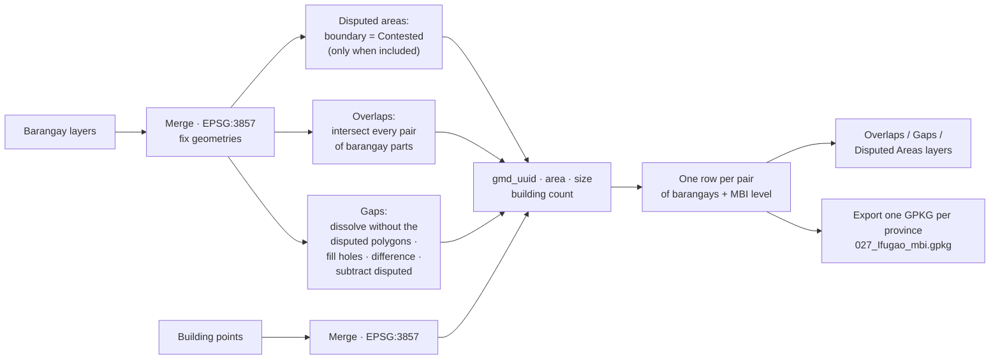

# National-Level MBI Checker

**Script:** [`gmd_processing_tools/national_mbi_checker.py`](../../gmd_processing_tools/national_mbi_checker.py)
**Menu:** GMD CO Processing › EA Tools › National-Level MBI Checker

Finds the **MBIs** (gaps, overlaps and disputed areas) between **barangay** polygons, at any scale up to
the whole country, and counts the building points inside each one. It is the barangay-level counterpart of the
[EA MBI Checker](EA_topochecker.md). The Barangay Selector tab of the [MBI Coverage Selector](mbi_coverage_selector.md) later chooses the
covering barangay of the MBIs that remain after review.

It opens as a standard QGIS Processing dialog; the right-hand panel of the dialog holds its help.

---

## Quick start

1. **Select Barangay Polygon Layer(s)** — tick every barangay layer to check (they are merged first).
2. **Select Building Point Layer(s)** — tick the building point layers.
3. **Include Disputed Areas** — off by default. Leave it **unticked** to ignore the contested polygons
   entirely: they are removed from the barangay layers before anything is checked, as if they had never
   been digitised. Tick it to report them (see [Disputed Areas](#disputed-areas) below).
4. **Analysis to Run** — **Overlaps and Gaps (plus Disputed Areas when included)**, **Overlaps Only**,
   **Gaps Only**, or **Disputed Only** — the last needs **Include Disputed Areas** ticked, otherwise the
   dialog refuses to run. (QGIS cannot hide an entry of a Processing dropdown, so the entry stays visible
   and says what it needs.)
5. Optional: tick **Export MBI layers as one GPKG per province, e.g. 027_Ifugao_mbi.gpkg** and pick the
   **Export folder** (default `C:\PSA-GIS\2026 1Map\Preliminary Output`). Export runs in the first mode only.
6. Click **Run**. The **Overlaps**, **Gaps** and — when included — **Disputed Areas** layers (and each
   exported province) are added to the project, styled with `mbi_checker.qml`.

> The input layers are never edited. Without export, the results are temporary layers — right-click ›
> **Make Permanent** to keep them.

---

## How it works

1. **Prepare.** The selected layers are merged (one barangay layer, one building layer), reprojected to
   EPSG:3857 and repaired (`native:fixgeometries`).
2. **Detect overlaps.** The barangays are split into single parts. Every pair of parts whose bounding boxes
   meet is intersected; each polygon piece of the intersection is one overlap, tagged with the two parts
   it comes from.
3. **Disputed areas.** With **Include Disputed Areas** *unticked* (the default),
   every contested polygon is dropped from both working layers here and nothing below ever sees it — there is
   no Disputed Areas layer, and the ground such a polygon covered can be reported as a **gap**, because as far
   as the check is concerned the polygon is not there. The rest of this step applies only when the box is
   **ticked**.
   A barangay polygon whose **`boundary`** field is **`Contested`** (any letter
   case) is a disputed area and is reported as it stands — the whole contested polygon, not a cut piece.
   The field name is matched whatever its letter case. If the barangay layers have no `boundary` field,
   the log warns and no disputed area is detected.
   Contested polygons are **still scanned for overlaps** — as in GEMMA's checker, an overlap between a
   claimant barangay and a contested polygon stays visible. Only the **gaps** exclude them.
4. **Detect gaps.** The **disputed polygons are left out** of the dissolve, the rest are dissolved into one
   shape, its holes are filled, and the original dissolved shape is subtracted. The footprint of the
   disputed polygons is then subtracted from the result, so a disputed area is never reported as a gap as
   well. What remains, split into single parts, are the gaps.
5. **Measure.** Each MBI gets a `case_uuid`, its area (`mbi_area`, rounded to 2 decimals), the
   width and height of its minimum bounding box, and the number of building points inside it
   (`num_bldg_pts`) and the sum of their household counts (`est_hhcount`).
6. **Find the involved barangays.**
   - **Overlap:** the two barangays it was cut from.
   - **Disputed area:** the contested polygon itself plus every barangay polygon within **0.50 m** of it —
     the barangays laying claim to it. The contested polygon stays the row's own area even when it has no
     `geocode`, and the **sliver rule does not apply** to it: a contested parcel is reported however small.
   - **Gap:** every barangay sharing more than **0.01 m** of edge with it (measured in EPSG:3857).
     Corner-only touches do not count — unless no barangay shares a clean edge, then all touching ones count.
   - Barangays without a `geocode` are left out, and a barangay repeated by its multiple parts counts once.
7. **Drop slivers.** An MBI of **0.1 m² or less with no building** is dropped.
8. **Write the rows.** A gap or overlap is written once per **ordered pair** of involved barangays (A → B
   and B → A), in EPSG:4326, with the MBI level between the two (below); one with a single involved
   barangay gets one row, level `5_Within-Barangay`.
   A **disputed area** gets **exactly one row** — the whole contested polygon is the case, so pair rows
   would only repeat it. That row carries the contested polygon's own attributes, the claimants in
   `involved_areas` / `involved_bgys`, and the MBI level across all of them.
9. **Export (optional, Overlaps, Gaps and Disputed mode).** Overlaps, Gaps and Disputed Areas are merged,
   with `mbi_type`,
   `mbi_status` and `mbi_remarks` added, then split by **province**: the first 3 digits of
   each row's `geocode`. Each province is written to its own GPKG, named after the code and the `province`
   field, and loaded into the project. A row belongs to its own barangay's province, so an inter-province
   MBI is in both provinces' files.

---

## MBI level

Taken from the first attribute that differs between the two barangays of the row:

| Differs | `mbi_level` |
|---------|-------------|
| `region` | `1_Inter-Region` |
| `province` | `2_Inter-Province` |
| `city_mun` | `3_Inter-City/Municipality` |
| `barangay` | `4_Inter-Barangay` |
| nothing (or a single barangay) | `5_Within-Barangay` |

The barangay layers need the fields `geocode`, `region`, `province`, `city_mun` and `barangay`.

For `est_hhcount`, each building point gives its **`est_hhcount`**, or its **`hhcount`** when `est_hhcount`
is empty; these are summed over the points inside the MBI. If the points have neither field, these are
used instead, in this order: `hh_count`, `est_hh`, `household_count`, `households`, `no_hh`, `num_hh`
(any letter case). A point with no value in any of them counts as 0.

---

## What gets written

**Overlaps** / **Gaps** layers (one row per ordered pair of involved barangays) and **Disputed Areas**
(one row per disputed case):

| Field | Contents |
|-------|----------|
| `case_uuid` | ID of the MBI — the same on all its rows |
| `geocode`, `region`, `province`, `city_mun`, `barangay` | This row's barangay |
| `mbi_level` | Level between this barangay and the other one of the pair (across every involved barangay, for a disputed area) |
| `involved_areas` | Geocodes of every involved barangay, comma-separated |
| `involved_bgys` | `barangay, city_mun` of every involved barangay, `;`-separated |
| `count_involved_areas` | Number of involved barangays |
| `num_bldg_pts` | Building points inside the MBI |
| `est_hhcount` | Sum of the household count of those building points (empty when the points have no household field) |

**Export** — one `<province code>_<Province>_mbi.gpkg` per province in the **Export folder**
(e.g. `027_Ifugao_mbi.gpkg`; spaces and symbols in the name become `_`, so `Nueva Vizcaya` →
`050_Nueva_Vizcaya_mbi.gpkg`). An existing file with the same name is replaced. Same fields, plus:

| Field | Contents |
|-------|----------|
| `mbi_type` | `Overlap`, `Gap` or `Disputed` |
| `mbi_remarks` | Empty, for the reviewer |
| `mbi_scope` | The MBI types this run looked for: `Gap,Overlap` or `Gap,Overlap,Disputed`. Lets the [Barangay Selector](mbi_coverage_selector.md#barangay-selector-rules) tell *not looked for* from *not found* — without it, disputed areas skipped by an unticked **Include Disputed Areas** would read as resolved. |
| `mbi_status` | `2_Pending` on every `Disputed` row, and on `1_Inter-Region` / `2_Inter-Province` rows; otherwise empty |

---

## Running without the dialog

Fill in `BGY_LAYER_NAMES` and `BLDG_LAYER_NAMES` (layer names as in the Layers panel), and optionally
`INCLUDE_DISPUTED` (`False` ignores the contested polygons, `True` reports them),
`RUN_MODE` (0 = Overlaps and Gaps · 1 = Overlaps Only · 2 = Gaps Only · 3 = Disputed Only, which needs
`INCLUDE_DISPUTED = True`), `EXPORT_MBI` and `EXPORT_FOLDER`, in the CONFIG block at the top of the script, then
run it. Progress prints to the panel log / Python console.

---

## Troubleshooting

| Problem | Fix |
|---------|-----|
| No layer added for overlaps | No overlaps were found — the log says *no overlapping areas found*. |
| `mbi_level` is always `5_Within-Barangay` | The barangay layers lack `region` / `province` / `city_mun` / `barangay`, or they are empty. |
| Several rows for one MBI | Normal for a gap / overlap: one row per ordered pair of involved barangays, all sharing the `case_uuid`. A disputed area always gets a single row. |
| An MBI is missing | It was 0.1 m² or less with no building (dropped as a sliver), or its barangays have no `geocode`. |
| Export ticked but no GPKG | Export runs only in the first mode (**Overlaps and Gaps …**); the folder must be writable. |
| No Disputed Areas layer | **Include Disputed Areas** is unticked — the contested polygons were ignored. The log says how many were removed. |
| No disputed areas found with the box ticked | The barangay layers have no `boundary` field (the log warns), or no polygon's `boundary` is `Contested`. |
| *'Disputed Only' needs 'Include Disputed Areas' ticked* | Exactly that — tick the box, or pick another mode. |
| A contested polygon's ground shows as a gap | Expected with the box unticked: the polygon is treated as absent, so the hole it filled is a gap. Tick the box to report it as Disputed instead. |
| A disputed area also shows as a gap | It should not — if it does, its `boundary` value is not exactly `Contested` (ignoring case and surrounding spaces). |
| *Could not replace … (open in QGIS?)* | That province's GPKG is open in QGIS — remove the layer and run again. |
| `est_hhcount` empty | The building points have none of the household fields listed under MBI level — the log warns about it. |
| File named `027_mbi.gpkg` | The barangays of that province have an empty `province` field. |
| Layers not styled | `gmd_processing_tools/styles/mbi_checker.qml` is missing. |
| Slow on a whole region | Every pair of touching barangay parts is intersected — run per region, or give the building layers a spatial index. |
